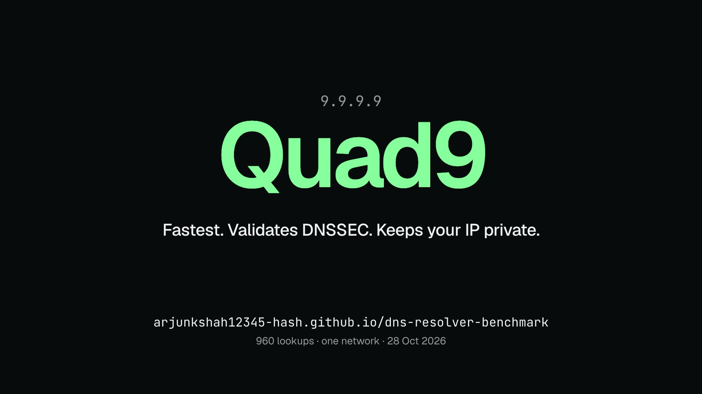

# Public DNS resolver benchmark

**Live:** https://arjunkshah12345-hash.github.io/dns-resolver-benchmark/ · **Video:** [`assets/dns-resolver-benchmark-15s.mp4`](assets/dns-resolver-benchmark-15s.mp4) (15 s, source in [`video/`](video))



13 resolvers measured from one Mac on one network, 28 October 2026. 40 interleaved rounds per resolver for plain DNS (cached and cache-miss lookups), 48 DNS-over-HTTPS (DoH) requests per endpoint over 3 connections, plus correctness checks.

## Results

Times are milliseconds. p50 is the median and p90 is the 90th percentile. A miss is a random never-seen name, which forces the resolver to ask the authoritative server.

| Resolver | Cached p50 / p90 | Miss p50 / p90 | DoH warm / new conn | Validates DNSSEC | Sends your subnet (ECS) | DoT |
| --- | --- | --- | --- | --- | --- | --- |
| Quad9 `9.9.9.9` | **11.7** / 13.8 | **13.8** / 27.5 | **17.9** / 91 | yes | no | yes |
| Level3 `4.2.2.1` | 12.9 / 14.9 | 14.8 / 34.6 | none | **no** | no | no |
| CleanBrowsing `185.228.168.9` | 13.7 / 14.7 | 18.0 / 28.6 | 22.4 / 143 | yes | no | yes |
| NextDNS `45.90.28.0` | 14.0 / 15.1 | 20.0 / 56.5 | **17.0** / 94 | yes | no | yes |
| Cloudflare `1.1.1.1` | 14.1 / 15.6 | 18.1 / 32.2 | 24.5 / 117 | yes | no | yes |
| Comodo `8.26.56.26` | 14.4 / 15.5 | 23.4 / 29.4 | none | **no** | no | no |
| OpenDNS `208.67.222.222` | 14.7 / **46.0** | 15.9 / 29.6 | 23.0 / 104 | yes | **/24** | yes |
| Control D `76.76.2.0` | 14.9 / 16.3 | 16.1 / 29.6 | 18.6 / 118 | yes | no | not on this IP |
| Google `8.8.8.8` | 25.0 / 38.9 | 35.6 / 40.9 | 28.4 / 122 | yes | **/24** | yes |
| AdGuard `94.140.14.14` | 25.1 / 26.0 | 32.8 / 38.2 | 28.9 / 138 | yes | **/24** | yes |
| Yandex `77.88.8.8` | 226.5 / 237.9 | 252.7 / 269.9 | 240.9 / 1,199 | **no** | no | yes |
| Mullvad | refuses plain DNS | | 82.2 / 381 | n/a | n/a | n/a |
| Network default (LAN) | 4.7 / 7.9 | 37.3 / 43.3 | none | **no** | **/24** (forwards to Google) | no |

The 12 plain resolvers answered all 960 timed queries (80 each) with no timeouts, and all 12 returned an honest NXDOMAIN for a made-up name; none redirected it to an ad page.

## What they block

Run on 29 Oct 2026 against 393 live domains drawn from lists no resolver vendor runs: [URLhaus](https://urlhaus.abuse.ch/) online malware hosts (via the [malware-filter](https://gitlab.com/malware-filter/urlhaus-filter) mirror), the [OpenPhish](https://openphish.com/) public feed, and [Peter Lowe's](https://pgl.yoyo.org/adservers/) ad and tracker list. Share of each list blocked:

| Resolver | Malware (150) | Phishing (94) | Ads & trackers (149) |
| --- | ---: | ---: | ---: |
| Control D Ads `76.76.2.2` | 97% | 99% | 98% |
| Control D Malware `76.76.2.1` | 83% | 98% | 3% |
| AdGuard `94.140.14.14` | 53% | 91% | 53% |
| Cloudflare Security `1.1.1.2` | 51% | 71% | 0% |
| Quad9 `9.9.9.9` | 61% | 59% | 1% |
| OpenDNS `208.67.222.222` | 5% | 88% | 1% |
| CleanBrowsing Security `185.228.168.9` | 79% | 9% | 0% |

Blocked nothing: Cloudflare `1.1.1.1`, Google, Control D `76.76.2.0`, NextDNS without an account, Comodo, Level3, Yandex and the network default. Google and Cloudflare `1.1.1.1` are the reference (below), so they score zero by design.

- **Comodo blocked 0 of 393**, though its resolver is sold as Secure DNS.
- **Quad9 is the only resolver in the fast group (within 3.2 ms on cached lookups) that blocks most of both lists**: 61% of malware and 59% of phishing, with no ad blocking. CleanBrowsing is as fast but misses most phishing; OpenDNS misses most malware.
- **The specialists split**: CleanBrowsing's security filter catches malware (79%) but almost no phishing (9%); OpenDNS is the reverse (88% phishing, 5% malware).
- **Several providers keep filtering on a second address.** Cloudflare's `1.1.1.2` and Control D's `76.76.2.1`/`.2` block a lot; their default addresses (the ones timed above) block nothing.

## What stands out

- **Quad9 is fastest on every plain measure here**, including cache misses (13.8 ms median), and its DoH is within 1 ms of the fastest (NextDNS, 17.0 ms).
- **Eight resolvers are within 3.2 ms of each other on cached lookups** (11.7 to 14.9 ms). From this network that gap is too small to feel. The real differences are in misses, tail latency and the privacy checks.
- **Google and AdGuard are about 11 ms slower than the pack** on cached lookups from this location, and Google is the slowest on misses among the major ones (35.6 ms).
- **OpenDNS has the worst tail of the fast group**: median 14.7 ms but p90 46.0 ms.
- **Your network's default resolver is the fastest on cache hits (4.7 ms, it's on the LAN) but slow on misses (37 ms), does not validate DNSSEC**, and forwards to Google with your /24 attached.
- **Three resolvers don't validate DNSSEC**: Level3, Comodo and Yandex all returned an address for `dnssec-failed.org`, a domain with a deliberately broken signature.
- **Google, OpenDNS and AdGuard pass the first 24 bits of your IP** (EDNS Client Subnet) to every authoritative server they query. That helps CDNs pick a nearby server, but it tells every domain owner roughly where you are.
- **Opening a new DoH connection costs 90 to 140 ms**, versus 17 to 29 ms on a warm one. Browsers keep the connection open, so warm is what you'll usually feel.
- **Yandex is about 15x slower** from here (no nearby node).

**From this network, Quad9 is the best overall pick**: fastest, validates DNSSEC and doesn't send your subnet. NextDNS and Cloudflare are close behind on all three.

## Method

- **Plain DNS:** raw UDP from Python (`scripts/bench.py`), 2 s timeout. Each round shuffles the resolver order so network drift hits all of them equally. Cached: one of 15 popular domains, all pre-warmed. Miss: a fresh random 14-character label under one of 6 unsigned parent zones, unique per resolver per round, so no resolver can use another's cache or synthesize the answer from DNSSEC NSEC records.
- **DoH:** RFC 8484 wire-format GETs with curl, 16 requests on one connection, 3 times. "New conn" is the first request, including TCP and TLS; "warm" is the median of the other 45.
- **Checks:** `dig` against `dnssec-failed.org` (DNSSEC), a random `.com` name (NXDOMAIN), Google's `o-o.myaddr.l.google.com` and Akamai's `whoami.ds.akahelp.net` TXT records (ECS), and a TLS connection to port 853 (DoT).
- **Blocking:** `scripts/filtering.py` samples up to 150 hosts per list, at most 10 per parent domain so one hosting platform can't dominate, and keeps only hosts that Google or Cloudflare still resolve. Every resolver gets the same names at the same time over UDP. A domain counts as blocked on NXDOMAIN, an empty answer, `0.0.0.0`/`127.x`, or a block-page address. A block-page address has to cover 3+ unrelated parent domains, never appear in a reference answer, and sit on a different network (origin ASN, via Team Cymru) from the real answers. That last rule keeps a resolver abroad that sees another CDN edge (Yandex gets different Cloudflare and Adobe addresses) from counting as blocking. Errors are re-asked once slowly: Control D answers REFUSED when one client queries several of its addresses at once, which is rate limiting, not blocking. A domain either reference lost during the run is treated as taken down and dropped (1 was). Only hostnames were resolved; nothing was visited.
- **Re-run:** the first DoH pass was lost to a network drop partway through, so DoH was re-run on its own, finishing at 18:11 PDT. The plain rounds began at 16:40 PDT.
- **Limits:** one machine, one network and one evening. Anycast routing means the order will differ from other places, so treat gaps under about 3 ms as noise. Blocking is one pass on one day's lists, and threat lists go stale within hours, so expect the percentages to move by several points between runs.
- **Privacy:** your public IP shows up in the ECS checks. It is redacted to `x.x.x.x` in `raw/features.json` and never written to `raw/summary.json`.

## Layout

- `scripts/bench.py` runs the measurements and writes `raw/samples.json` and `raw/features.json`.
- `scripts/analyze.py` writes `raw/summary.json`, which the site reads.
- `scripts/filtering.py` runs the blocking test and writes `raw/filtering.json` (every answer, plus cached ASN lookups) and `raw/filtering-summary.json` (counts, read by the site). The downloaded lists go in `raw/feeds/`, which is gitignored because phishing URLs can carry victims' email addresses. `--reclassify` re-scores saved answers without querying again.
- `index.html` is the whole site, with no build step.
- `video/` is the HyperFrames source for the video: `npx hyperframes render` inside it.

Found something wrong? Open an issue with a link and it will be corrected.

## Run it

```bash
ROUNDS=40 python3 -I scripts/bench.py <your-default-resolver-ip>
python3 -I scripts/analyze.py
python3 -I scripts/filtering.py <your-default-resolver-ip>
```
